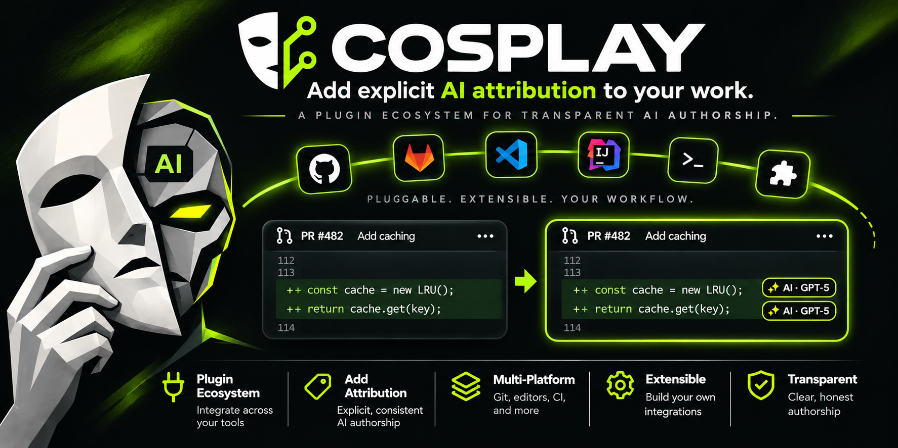

# cosplaying



`cosplaying` adds an attribution byline to text that a coding agent sends through a command-line tool. The byline identifies the model and includes a link to your AI policy.

A plugin controls each command-line tool. The package includes plugins for Git (`git`) and the GitHub CLI (`gh`). You can also develop plugins for other tools.

- [Install cosplaying](#install-cosplaying)
- [Use plugins](#use-plugins)
- [Set the attribution text](#set-the-attribution-text)
- [Set the session instructions](#set-the-session-instructions)
- [Develop a plugin](#develop-a-plugin)

## Install cosplaying

The software requirements are Node.js 22 or a subsequent version, and the command-line tools for your plugins.

1. Install the package:

   ```sh
   npm install -g cosplaying
   ```

2. Enable the applicable plugins:

   ```sh
   cosplaying plugin enable git
   cosplaying plugin enable gh
   ```

3. Install the agent hooks:

   ```sh
   cosplaying install
   ```

4. Give approval for the hooks in your coding agent:

   | Coding agent | Action |
   | --- | --- |
   | Codex | Open `/hooks`. Give approval for the cosplaying hooks. |
   | Claude Code | Give approval for the command hooks at the Claude Code prompt. |
   | Gemini CLI | Give approval for the hooks at the Gemini CLI prompt. |

5. Start a new agent session.

6. Do a check of the installation:

   ```sh
   cosplaying doctor
   ```

The install command writes hooks for Claude Code, Codex, Cursor, Gemini CLI, OpenCode, and Pi. It does not enable plugins. It writes the hook files even if an agent executable is not on `PATH`.

The doctor command checks the hook files, plugins, and configuration. It cannot read hook approval from your coding agent. A missing agent executable does not cause an error.

### Install hooks for a project

By default, the install command writes hooks to your user configuration. For project hooks, use `--project-dir`:

```sh
cosplaying install --project-dir /path/to/repo
cosplaying doctor --project-dir /path/to/repo
```

To select one coding agent, use its harness ID:

```sh
cosplaying install --harness codex
```

A harness is the coding agent that calls the hooks. The harness IDs are `claude-code`, `codex`, `cursor`, `gemini`, `opencode`, and `pi`.

Cursor cloud agents do not use user hooks. Use project hooks for those agents.

### Repair or remove hooks

If the Node.js path changes, repair the hooks:

```sh
cosplaying doctor --repair
```

After you install or repair the hooks, give approval for the Codex hooks again through `/hooks`. Codex uses the hook hash to record approval.

If an `rtk hook` entry follows cosplaying, doctor moves the cosplaying hook to the end. This hook sequence prevents `rtk` from removing the cosplaying command prefix.

To remove user hooks:

```sh
cosplaying uninstall
```

To remove project hooks:

```sh
cosplaying uninstall --project-dir /path/to/repo
```

Uninstall removes only hooks that cosplaying owns. It does not replace or delete an unmarked Pi or OpenCode extension file.

## Use plugins

The Git and GitHub CLI plugins are off by default. To enable or disable them, use these commands:

```sh
cosplaying plugin enable git
cosplaying plugin enable gh
cosplaying plugin disable git
cosplaying plugin disable gh
```

These commands change your user configuration. A project `plugins` list replaces the user list. If a project list keeps a plugin disabled, add the plugin to that list.

The plugin documents give the supported operations and restrictions:

| Plugin | Documentation |
| --- | --- |
| Git | [Git plugin](plugins/git/README.md) |
| GitHub CLI | [GitHub CLI plugin](plugins/gh/README.md) |

### Supply the model name

Installed hooks supply the model from the agent session. If the session does not supply a model name, the hooks use the harness label.

For a command that you enter directly, use `--model` before `--`:

```sh
cosplaying hook --model "MODEL_ID" -- gh issue view 123
```

Replace `MODEL_ID` with the current model ID. You can also set `COSPLAYING_MODEL` in the environment.

For a direct command, cosplaying selects the first available model source in this sequence:

1. `--model` or `--model-base64`.
2. `COSPLAYING_MODEL`.
3. The label for `--harness`, if you supply this option.

Without these sources, the model name is empty. A plugin must stop a text write if the model name is empty.

Use plain text with `--model`. Installed hooks use `--model-base64` for base64url text. An empty option value or an incorrect encoding stops the command.

### Know the hook limits

The shell hook changes registered plugin commands to use `cosplaying hook`. It does this for read commands and write commands. Each plugin controls attribution for its operations.

The shell hook can change commands in pipelines, substitutions, loops, and unquoted heredocs. It cannot change commands inside script files, `eval` strings, or `bash -c` strings.

For those commands, call `cosplaying hook` directly. For an `rtk` command prefix, the hook uses `rtk proxy`. It does not change command text inside an `rtk run` string.

If a plugin stops a command, correct the input. If you cannot correct the input, get instructions from the user. Do not bypass cosplaying.

### Install a plugin from a directory or repository

You can install a plugin from a local directory or a GitHub repository:

```sh
cosplaying plugin install ./my-plugin
cosplaying plugin install OWNER/REPOSITORY
cosplaying plugin list
```

Replace `OWNER/REPOSITORY` with the GitHub owner and repository name.

Installed plugins load automatically. To replace an installed plugin, first remove it:

```sh
cosplaying plugin uninstall my-plugin
cosplaying plugin install ./my-plugin
```

## Set the attribution text

Use one of these configuration filenames:

- `.cosplaying.json`
- `.cosplaying.yaml`
- `.cosplaying.yml`

For user settings, put the file in `~/.config/cosplaying`. For project settings, put the file in your project directory.

`cosmiconfig` searches for project settings from the current directory. Its project search stops at a directory with `package.json`. The configuration sequence is defaults, user settings, then project settings.

Subsequent settings replace previous settings. The `variables` objects merge. A project `plugins` list replaces the user list; it does not extend that list.

This example enables the two included plugins and sets the attribution text:

```json
{
  "link": "https://example.com/ai-policy",
  "plugins": ["git", "gh"],
  "variables": { "team": "Docs" },
  "attribution": {
    "templates": {
      "markdown": "AI model: {model}. Team: {team}. [AI policy]({link}).",
      "trailer": "{model} via cosplaying ({link})."
    }
  }
}
```

`{model}` contains the model name. `{link}` contains the policy URL. The `variables` object supplies other template values, such as `{team}`.

`replaces` fills the template values. The `{model}` tag is optional. cosplaying does not check tag names against a fixed list.

The default link is `https://github.com/3rd-eden/cosplaying`. The default templates are:

| Template | Default text |
| --- | --- |
| `markdown` | `Authored by {model} via [cosplaying]({link}). AI Assisted text may contain mistakes, please verify.` |
| `trailer` | `{model} via cosplaying ({link}). AI Assisted text may contain mistakes, please verify.` |

The Markdown renderer adds these markers around the byline:

```html
<!-- cosplaying:attribution -->
<!-- /cosplaying:attribution -->
```

Do not put these markers in a template. The trailer renderer adds the `AI-Assisted-By:` key. The trailer text must stay on one line. A policy URL must use HTTP or HTTPS.

Do not set `model` or `attribution.model` in a configuration file. Supply the model for each command or agent session.

## Set the session instructions

The session start hook sends instructions to the coding agent. Set those instructions with `prompts` in the same configuration file.

`prompts.session` is used when one or more plugins change shell commands. `prompts.empty` is used when no plugin changes shell commands. `attribution.templates.session` supplies the session text when `prompts.session` is absent. `attribution.templates.empty` supplies the empty text when `prompts.empty` is absent.

This example sets both prompts:

```json
{
  "prompts": {
    "session": "You are running in {harness}. For {commands}, prefix the command with {executable} hook --model <current model id> --. Team: {team}. Policy: {link}.",
    "empty": "No cosplaying plugins are installed for {harness}. Do not invent wrapped commands."
  }
}
```

`{harness}` is the coding agent name. `{commands}` is the plugin command list in alphabetical order. `{executable}` is the cosplaying command. `{model}` is the model name for the session. `{link}` is the policy URL. The `variables` object supplies other values, such as `{team}`.

The default prompts are:

| Prompt | Default text |
| --- | --- |
| `session` | `For authored writes with {commands}, prefix the command with {executable} hook --model <current model id> --. You are running in {harness}. When you know the model id, pass it as plain text with --model. Installed hooks pass --model-base64 for you. Write authored text in ASD-STE100 Simplified Technical English. If a command is blocked, correct the input or ask the user. Never bypass cosplaying for those commands.` |
| `empty` | `No cosplaying plugins are installed. Do not invent wrapped commands. Write authored text in ASD-STE100 Simplified Technical English.` |

A failed hook-order check appends the hook file names and the `cosplaying doctor --repair` instruction after the selected prompt.

## Develop a plugin

A plugin is a Node.js package. Use ESM JavaScript. The package name identifies the command that the plugin controls. For a scoped package, the command name excludes the scope.

For example, the included package named `git` controls the `git` command. The command executable must also be available on `PATH`.

Do not use these command names for a plugin: `hook`, `agent-hook`, `rewrite`, `install`, `uninstall`, `doctor`, or `plugin`.

### Create the package

1. Create a directory named `my-plugin`.

2. Add this `package.json` file:

   ```json
   {
     "name": "my-plugin",
     "version": "1.0.0",
     "type": "module",
     "main": "./index.js"
   }
   ```

3. Add `my-plugin/index.js` with the entry point from the next section.

4. Install the plugin:

   ```sh
   cosplaying plugin install ./my-plugin
   ```

5. Read the plugin list:

   ```sh
   cosplaying plugin list
   ```

Set `name` in `package.json` to the command that your plugin controls. The name `my-plugin` is a placeholder. For complete implementations, refer to the [Git plugin](plugins/git/index.js) and the [GitHub CLI plugin](plugins/gh/index.js).

For development without an installed copy, add the plugin directory to your project configuration:

```json
{
  "plugins": ["git", "gh", "./my-plugin"]
}
```

A relative plugin path starts at the current directory.

### Implement the entry point

The default export is an asynchronous function with this interface:

```js
export default async function run(args, context) {
  // Apply the command rules here.
  const result = await context.spawn(context.realBin, args, {
    cwd: context.cwd,
    env: context.env,
    stdio: 'inherit',
  });
  return result?.status ?? 1;
}
```

This example only passes arguments to the executable. It does not add attribution. The function must return a numeric exit code.

Optional named exports control help text and shell hooks:

| Export | Function |
| --- | --- |
| `description` | Supplies the plugin help text. |
| `examples` | Supplies an array of example commands for help text. |
| `intercept` | Enables automatic shell changes. The default is `true`. |

If `intercept` is `false`, users can call the plugin through `cosplaying hook` directly.

### Use the context

cosplaying passes these values to the entry point:

| Value | Function |
| --- | --- |
| `args` | Contains the command arguments, without the command name. |
| `context.model` | Contains the model name or an empty string. |
| `context.harness` | Contains the harness ID or an empty string. |
| `context.cwd` | Contains the current directory. |
| `context.env` | Contains the child process environment. |
| `context.realBin` | Contains the executable path. |
| `context.spawn` | Starts a child process and supplies its `status`. |
| `context.stdin`, `context.stdout`, `context.stderr` | Supply the input, output, and error streams. |
| `context.attribution.annotateMarkdown(text)` | Adds the Markdown byline to text. |
| `context.attribution.renderTrailer()` | Supplies the `AI-Assisted-By` key and its value. |

Always pass `context.env` to child processes. It contains `COSPLAYING_INSIDE_HOOK=1`. This value prevents a nested hook from adding attribution again.

To select an executable directly, set `COSPLAYING_<COMMAND>_BIN` to an absolute file path. Use uppercase letters for `<COMMAND>`. Replace each character other than a letter or digit with `_`.

### Control text writes

Your plugin must identify the operations that write text. Apply these rules before the child process starts:

1. If the model name is empty, stop the text write.
2. Add attribution through the helpers in `context.attribution`.
3. If an attribution helper throws an error, stop the text write.
4. Use a temporary copy for file input.
5. Keep the source file unchanged.

Use `withAttributedCopy` from `cosplaying/plugin` for UTF-8 file input. It makes a temporary copy with mode `0600`. It removes the copy after your callback completes.

To stop a command, call `block` from `cosplaying/plugin`:

```js
import { block } from 'cosplaying/plugin';

block(context.stderr, 'This text write needs a model. Use --model <name> or set COSPLAYING_MODEL.');
return 2;
```

Put this code inside your entry point. `block` writes the error message to the error stream. It does not stop execution. Return exit code `2` before you start a child process.

The error message must identify the incorrect input and the necessary correction. Do not recommend a command that bypasses cosplaying.

For more details, refer to the [plugin API](packages/plugin/README.md) and the [attribution API](packages/attribution/README.md).

## Attribution limits

The byline is text that a person can read. It does not prove who wrote the text. It is not a cryptographic watermark.

A deployer can use the Markdown block as a disclosure when EU AI Act Article 50(4) applies. cosplaying does not decide whether Article 50(4) applies to a text.

The `AI-Assisted-By` trailer is not an Article 50(2) machine-readable marking solution. This project does not claim Article 50(2) compliance.

## Command help and errors

For command options:

```sh
cosplaying --help
cosplaying hook --help
cosplaying plugin --help
```

`rewrite` prints command text with the hook changes. `agent-hook` processes events from a coding agent; it is not for commands that you enter directly.

For error causes and corrections, refer to the [error catalog](docs/errors.md).
