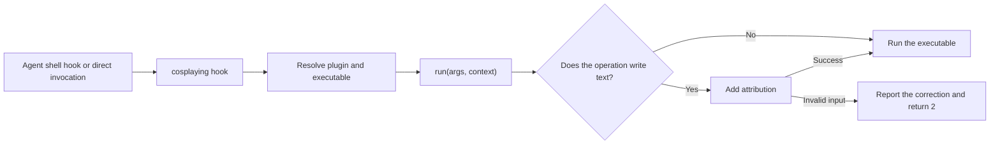

# Plugin API

A cosplaying plugin controls one command-line tool. It decides which operations write text, adds attribution to that text, and starts the real executable. Plugin code can import helpers from `cosplaying/plugin`. To run the examples, install the [cosplaying CLI](../../README.md#install-cosplaying) with Node.js 22 or later.

- [Write a plugin](#write-a-plugin)
- [Use the hook context](#use-the-hook-context)
- [Load and install plugins](#load-and-install-plugins)
- [Loader reference](#loader-reference)

## Write a plugin

Each plugin is a Node.js package. The unscoped package name is the command it controls. For example, `@example/publish-note` controls `publish-note`. Start the command name with a letter or digit. The remaining characters can be letters, digits, underscores, or hyphens. The names `hook`, `agent-hook`, `rewrite`, `install`, `uninstall`, `doctor`, and `plugin` are reserved.

cosplaying imports the JavaScript file in `package.json#main`. Keep that file inside the plugin directory. Use a default export of `run(args, context)` or an object with a `run` method. Return a numeric exit code. For a function export, put `description`, `examples`, and `intercept` in named exports. For an object export, put them on that object. The first two supply help text. Set `intercept: false` to require an explicit `cosplaying hook` invocation. Shell hooks intercept commands by default.



<details>
<summary>Try a complete plugin with inline text and file input</summary>

This example uses a local command called `publish-note`. The command prints the text it receives. The plugin passes through `--help`, adds a Markdown byline to inline text, and uses a temporary copy for file input.

In a scratch directory, create `publish-note/package.json`.

```json
{
  "name": "publish-note",
  "version": "1.0.0",
  "type": "module",
  "main": "./index.js"
}
```

Run `npm install cosplaying` in the plugin directory so Node can resolve the helper import. Then save this entry point as `publish-note/index.js`.

```js
import path from 'node:path';
import { block, withAttributedCopy } from 'cosplaying/plugin';

export const description = 'Add a byline to note text.';
export const examples = ['publish-note --body "The build passed."'];

export default async function run(args, context) {
  const execute = async (argv) => {
    const result = await context.spawn(context.realBin, argv, {
      cwd: context.cwd,
      env: context.env,
      stdio: 'inherit',
    });
    return result.status ?? 1;
  };

  if (args.length === 1 && args[0] === '--help') {
    return execute(args);
  }

  const [flag, value] = args;
  if (args.length !== 2 || !value || !['--body', '--body-file'].includes(flag)) {
    block(context.stderr, 'Supply --body <text> or --body-file <path>.');
    return 2;
  }

  if (!context.model) {
    block(context.stderr, 'Supply --model <name> before -- or set COSPLAYING_MODEL.');
    return 2;
  }

  try {
    const annotate = context.attribution.annotateMarkdown;
    if (flag === '--body-file') {
      return await withAttributedCopy(
        path.resolve(context.cwd, value),
        annotate,
        (copyPath) => execute([flag, copyPath]),
      );
    }
    return await execute([flag, annotate(value)]);
  } catch (error) {
    block(context.stderr, error.message);
    return 2;
  }
}
```

In the scratch directory, save this POSIX shell script as `print-note` and run `chmod +x print-note`.

```sh
#!/bin/sh
case "$1" in
  --help) printf '%s\n' 'publish-note --body <text> | --body-file <path>' ;;
  --body) printf '%s\n' "$2" ;;
  --body-file) cat -- "$2" ;;
  *) exit 2 ;;
esac
```

Save this project configuration as `.cosplaying.json` in the scratch directory.

```json
{
  "plugins": ["./publish-note"],
  "attribution": {
    "templates": {
      "markdown": "> AI-assisted by {model}."
    }
  }
}
```

Run these commands from that directory. The override points cosplaying to the local script.

```sh
export COSPLAYING_PUBLISH_NOTE_BIN="$PWD/print-note"

cosplaying hook -- publish-note --help
cosplaying hook --model "Example Model" -- publish-note --body "The build passed."

printf '%s\n' 'The build passed.' > note.md
cosplaying hook --model "Example Model" -- publish-note --body-file note.md
```

Both text writes print the same body and byline. `note.md` still contains the original sentence. If you repeat either text write without a model and with `COSPLAYING_MODEL` unset, the plugin prints a correction and exits with status `2`.

```markdown
The build passed.

<!-- cosplaying:attribution -->
> AI-assisted by Example Model.
<!-- /cosplaying:attribution -->
```

</details>

## Use the hook context

`args` is an array of command arguments. It starts after the executable name. The second argument, `context`, contains the values below.

| Value | Use |
| --- | --- |
| `model`, `harness` | Model name and harness ID. Each can be an empty string. |
| `cwd`, `home`, `platform` | Working directory, user home, and Node.js platform. Resolve relative input paths from `cwd`. |
| `realBin`, `spawn` | Executable path and process launcher. Return the child process status to the caller. |
| `env` | Child process environment. Pass it to `spawn` so `COSPLAYING_INSIDE_HOOK=1` prevents a nested hook from applying attribution again. |
| `stdin`, `stdout`, `stderr` | Invocation streams for input, output, and errors. |
| `attribution.annotateMarkdown(text)` | Returns the body with a Markdown byline. It replaces a trailing cosplaying block on edits. |
| `attribution.renderTrailer()` | Returns a complete `AI-Assisted-By` trailer line. |

The attribution helpers already have the invocation model and the configured template, link, and variables. Use them before you start a text write. If the model is empty or a renderer fails, call `block(context.stderr, reason)` with the correction and return `2`. The helper prints the standard block message. Your `return` stops execution.

For a file input, call `await withAttributedCopy(sourcePath, render, work)`. It reads the source as UTF-8 and calls `render(text)` before making the copy. It writes the copy in the OS temporary directory with mode `0600` and the source extension. It passes the copy path to `work`, waits for the callback, and attempts to delete the copy when the callback returns or throws. The source file stays intact. The helper returns the callback result. [Attribution API](../attribution/README.md)

To select the executable, set `COSPLAYING_<COMMAND>_BIN` to an absolute path to a regular file. Convert the command to uppercase and replace each character other than a letter or digit with `_`. If the variable is unset, cosplaying searches `PATH`. It skips matches that would run cosplaying again.

### Verify the plugin contract

List the operations the tool supports before you decide which ones to pass through. For each supported text write, identify every input form the tool can use, such as an argument, file, or stdin. If the tool can also open an editor or browser, require the final text in a form the plugin can attribute before starting the process.

| Run through `cosplaying hook` | Expected result |
| --- | --- |
| Read-only operation without a model | The executable receives the original arguments and its exit status is returned. |
| Supported write with a model | The executable receives the attributed text. Other arguments keep their values. |
| Edit of text with a trailing cosplaying block | The outgoing Markdown has one current trailing byline. |
| Supported file input | The executable reads the attributed copy. The source is intact and the copy is removed after the command. |
| Supported write with a missing model, unusable template, or unreadable input file | The plugin reports the correction, returns `2`, and leaves the executable unstarted. |
| Executable returns a nonzero status | The plugin returns that status to the caller. |

Use a temporary home and working directory when checking a plugin under development. Point the executable override at a local command that prints what it receives, as in the tutorial. Use `cosplaying rewrite` to check automatic routing without executing the tool. [Inspect routing](../cli/README.md#inspect-routing-before-a-write)

## Load and install plugins

During development, put the plugin directory in the project `plugins` list. cosplaying resolves relative paths from the invocation directory. A directory load uses the directory name and `index.js` when the manifest omits `name` and `main`.

For a local install, supply `name`, `version`, and `main` in the manifest. Remove the development path from your configuration before you install the same command. An installed plugin loads on subsequent invocations, and a configured path for the same command causes a duplicate error.

```sh
cosplaying plugin install ./publish-note
cosplaying plugin list
cosplaying plugin uninstall publish-note
```

You can also install from a GitHub repository with `cosplaying plugin install OWNER/REPOSITORY`. To replace an installed plugin, uninstall it first. The bundled `git` and `gh` plugins load when enabled by name. An installed plugin for the same name takes precedence. [Plugin commands and configuration](../../README.md#use-plugins)

<details>
<summary>Where cosplaying stores plugins and dependencies</summary>

Plugins are stored in `~/.local/share/cosplaying/plugins`. An absolute `XDG_DATA_HOME` changes the location to `$XDG_DATA_HOME/cosplaying/plugins`. Scoped packages use a directory such as `plugins/@example/publish-note`.

`live-plugin-manager` installs local packages and GitHub repositories. It also installs registry and GitHub dependencies. If the installed package declares production dependencies and has no `node_modules` directory, cosplaying runs `npm install --ignore-scripts --omit=dev` there. For a local install, relative `file:` dependencies resolve from the original plugin directory.

Each CLI invocation reads the installed package directories and imports their entry points by file URL.

</details>

## Loader reference

Most plugin entry points use only `block` and `withAttributedCopy`. The CLI uses these additional exports.

| Export | Result |
| --- | --- |
| `RESERVED_COMMANDS` | Set of built-in command names a plugin cannot use. |
| `pluginDataDirectory({ env, home })` | Installed plugin directory. |
| `loadInstalledPlugins(options)` | Installed records, sorted by command. |
| `loadConfiguredPlugins(entries, options)` | Installed records first, then configured paths and bundled names. Pass `cwd` to resolve paths and `bundled` to supply the name-to-directory map. |
| `listPlugins(options)` | Installed records with `name`, `command`, `kind`, and `directory`. |
| `installPlugin(source, options)` | `{ ok: true, name, directory }` or `{ ok: false, error }`. |
| `uninstallPlugin(name, options)` | `{ ok: true }` or `{ ok: false, error }`. Accepts the package name or command. |
| `resolveRealBin(command, { env, cliPaths })` | `{ bin }` or `{ error }`. Pass the paths to cosplaying in `cliPaths` to prevent recursion. |
| `defaultSpawn(command, args, options)` | Process launcher that the hook supplies as `context.spawn`. |

The load functions return records with `name`, `command`, `kind`, `directory`, `entry`, and `descriptor`. The descriptor contains the entry function and the help and interception fields. The record kind is `path` or `bundled`. The configured loader rejects unknown names and duplicate commands. A configured name that already refers to an installed plugin counts once.

Await `context.spawn` with either output mode. With `encoding`, `input`, or a `stdio` array that includes `'pipe'`, it returns a `spawnSync` result. Otherwise it returns a promise. A launch failure reports the executable override and returns status `127` with an error. On Windows, `.cmd` and `.bat` launch through `cmd.exe`. Other executables launch directly.

For shipped examples, see the [Git plugin](../../plugins/git/README.md) and the [GitHub CLI plugin](../../plugins/gh/README.md).
